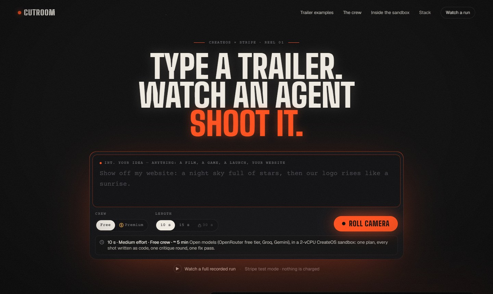
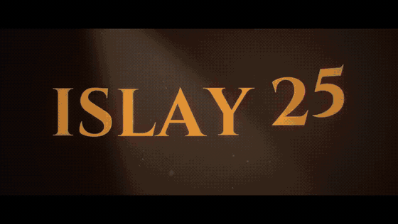
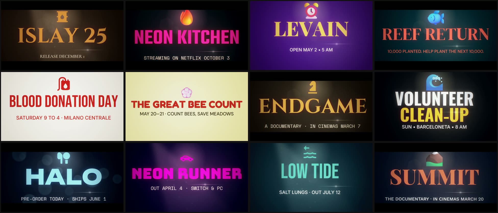
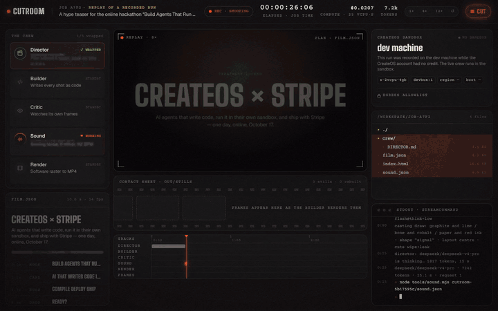
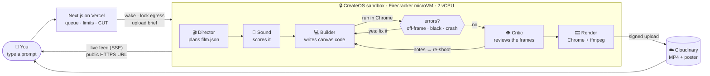

<div align="center">

# 🎬 Cutroom

### Type a trailer. Watch an agent shoot it.

An AI film crew that writes your trailer **as code** inside a **CreateOS sandbox**, runs it, watches its own frames,
fixes what's broken and hands you an MP4. **No GPU. No diffusion. Every frame is a program.**

[](https://cutroom-vert-psi.vercel.app)
[](https://cutroom-vert-psi.vercel.app/jobs/demo)


<sub>Built for the <b>CreateOS × Stripe Projects — "Build Agents That Run Code"</b> hackathon · October 17, 2026</sub>

<br/>

<a href="https://cutroom-vert-psi.vercel.app"></a>

</div>

---

## 🎞 What comes out

One sentence in, one MP4 out — no hands on the edit. A few of the films the crew shot from a single prompt:

<div align="center">

<br/><br/>
<a href="https://cutroom-vert-psi.vercel.app/#screening"></a>
<br/>
<sub>12 prompts · 12 films · average <b>3:57</b> from prompt to MP4 · <b>$0</b> on the Free crew · ~<b>$0.16</b> on Premium ·
<a href="https://cutroom-vert-psi.vercel.app/#screening">open the screening room →</a></sub>
</div>

## 🎥 Watch it work

The **studio floor** streams everything the crew does inside the sandbox, live: who's working, the script, the monitor,
the contact sheet, every file written, every command run, the timeline — then the premiere.

<div align="center">

<br/>
<sub>A recorded run replayed at 8× — <a href="https://cutroom-vert-psi.vercel.app/jobs/demo">watch it in the browser</a></sub>
</div>

## 🤔 The problem

Small businesses, indie makers and event organizers need short promo videos — a launch, a sale, an event, a
milestone — but a motion designer is expensive and After Effects takes months to learn. Generative video models are
costly and hard to control: the text comes out garbled and the brand gets lost.

**Cutroom writes the video as code.** The words are exact, the result is reproducible, and every frame can be inspected
and fixed — by the agent itself.

## 🧠 How it works



| | Agent | What it does |
|---|---|---|
| 🎬 | **Director** (LLM) | Turns your sentence into `film.json`: request type, beats, words, look, fonts, music |
| 🎵 | **Sound** (code) | Scores the trailer from the plan with real instrument samples (`audio/mix.wav`) |
| 💻 | **Builder** (LLM) | **Writes a signature shot in canvas code, runs it in the sandbox, reads the errors and rewrites it until it passes** |
| 👁 | **Critic** (vision LLM) | Looks at the contact sheet, writes up to 3 notes; the shots are patched and re-shot |
| 🎞 | **Render** (Chrome + ffmpeg) | `final.mp4` at 720p with the score, plus a poster |

**Two crews.** **Free** runs open models on OpenRouter's free tier, falling back to Groq and Gemini free tiers when one
is busy. **Premium** runs **Claude Sonnet 5.5** for every role, capped at $0.40 per trailer and 3 trailers per visitor.

### 🔁 The agent loop: write → run → fix

This is the heart of the brief, and it's visible on the studio floor. The Builder's shot is rendered **inside the
sandbox** at its start, middle and end, and measured; a crash, a black frame or an empty frame comes back to the model
as feedback it has to fix ([`pipeline/pipeline.mjs`](pipeline/pipeline.mjs), `lib/shotcheck.mjs`). The kind of
exchange it produces (abridged):

```text
builder  ▸ writes shots/world.js
sandbox  ▸ renders the shot at start · middle · end
sandbox  ✗ the frame at 2.4 s is almost black (mean brightness 0.19 of 255): the words must be clearly visible
builder  ▸ rewrites shots/world.js
sandbox  ✓ shot kept
critic   ▸ up to 3 notes on the contact sheet → patched → re-shot
```

## ⚡ How we used CreateOS Sandbox

<table>
<tr><td width="50%" valign="top">

**🔒 The agent's code only runs in the sandbox**<br/>
Every shot the Builder writes is rendered by headless Chrome inside a Firecracker microVM (`s-2vcpu-4gb`,
`devbox:1`). Output and exit codes go back to the agent — never executed on our server.

</td><td width="50%" valign="top">

**🧱 Egress control**<br/>
Before the crew starts, egress is locked to **12 hosts**: the model providers, fonts, icons, the media CDN and the app.
Code written by the agent can't reach anything else.

</td></tr>
<tr><td valign="top">

**🌐 Live URL (ingress)**<br/>
The crew serves its event feed (SSE) and frames on port 8080; the browser connects straight to the sandbox's public
HTTPS URL. That's how the studio floor is live.

</td><td valign="top">

**♨️ A warm sandbox, provisioned once**<br/>
`setup-sandbox.mjs` uploads the crew + engine (223 MB), installs ffmpeg and Chrome and test-renders in **~90 s**. Jobs
then wake it in **~100 ms**, waiting out any in-flight pause/resume first.

</td></tr>
</table>

| Measured inside the VM | 1 vCPU / 1 GB | **2 vCPU / 4 GB** |
|---|---|---|
| Render one still | 8.4 s | **2.8 s** |
| Render 4 s of video | didn't finish in 4 min | **24 s** |
| VM up after create | 45–85 ms | **34 ms** |

Code: [`web/src/lib/server/createos.ts`](web/src/lib/server/createos.ts) (boot, egress, crew start) ·
[`web/scripts/setup-sandbox.mjs`](web/scripts/setup-sandbox.mjs) (provisioning)

## 💳 How we used Stripe Projects

The **entire stack** was provisioned from one terminal during the event, starting from an empty directory — every
service on a free plan, with no payment method attached, so nothing can be charged:

```bash
stripe projects init cutroom
stripe projects add createos/free  && stripe projects add createos/project    # ⚡ the sandbox
stripe projects add openrouter/api                                            # 🧠 the crew's models
stripe projects add vercel/hobby   && stripe projects add vercel/project      # ▲ this app
stripe projects add upstash/redis --config '{"price":"free"}'                 # 🗂 job queue and state
stripe projects add cloudinary/free && stripe projects add cloudinary/media   # ☁️ MP4 + poster CDN
```

| Provider | Service | Used for | Plan |
|---|---|---|---|
| CreateOS | `project` | The sandbox the crew runs in | Free + hackathon credits |
| OpenRouter | `api` | Director, Builder, Critic models | Free models + $5 for Premium |
| Vercel | `project` | The Next.js app | Hobby |
| Upstash | `redis` | Jobs, queue, locks, quotas | Free |
| Cloudinary | `media` | Finished MP4s and posters | Free |

Credentials land in `.env` and `.projects/vault` (both gitignored); only the service list
([`.projects/state.json`](.projects/state.json)) is committed. Premium trailers can also go through **Stripe Checkout**
in test mode (`PAYMENTS=on`).

## 🛠 Tech

**Next.js 16** on Vercel · **CreateOS Sandbox** (`@nodeops-createos/sandbox`) · **Stripe Projects** · Stripe Checkout
(test mode) · **OpenRouter** (+ Groq, Gemini fallbacks) · **Upstash Redis** · **Cloudinary** · headless **Chrome** +
**ffmpeg** inside the sandbox.

<details>
<summary><b>🚀 Run it locally</b></summary>

<br/>

```bash
git clone https://github.com/franksignorini/cutroom-hackathon && cd cutroom-hackathon
stripe projects pull          # or: cp .env.example .env and fill it in
cd web && npm install && npm run dev
```

- `/` — the landing page · `/jobs/demo` — the studio floor replaying a recorded run (no keys needed)
- `PIPELINE=simulate` — the whole job system on a recorded run
- `PIPELINE=local` — the crew runs on your machine
- `PIPELINE=live` — the crew runs in the CreateOS sandbox (`node pipeline/pack.mjs`, then
  `node web/scripts/setup-sandbox.mjs`)

Every variable is listed in [`.env.example`](.env.example).

</details>

<details>
<summary><b>📁 Repository layout</b></summary>

<br/>

| Path | What's inside |
|---|---|
| [`web/`](web/) | Next.js app: landing, studio floor, job API, CreateOS boot, Stripe Checkout and webhook |
| [`pipeline/`](pipeline/) | The crew that runs inside the sandbox: agents' prompts, LLM router, feed server, film page |
| [`tools/`](tools/) | Recording, cost and screening helpers |
| [`media/`](media/) | The images and GIFs in this README |

</details>

## 🧾 Built before vs. during the event

In the spirit of transparency:

- **Before the event:** our code-rendered trailer engine (canvas film kit, renderer, sound — it lives outside this repo
  and is packed into the sandbox image), the crew pipeline (`pipeline/`), the studio web app (`web/`) and its tools.
- **During the event:** the Stripe Projects stack from an empty directory; the CreateOS account, EU endpoint and the
  2-vCPU warm sandbox; running the crew live in the sandbox (env handling, pause/resume races, lingering crews);
  Upstash, Cloudinary, Premium with spend caps and the Vercel deploy; copy, UI and this README.

<!-- TODO: ## 👥 Team — team name, members + Discord handles · demo video link -->

<div align="center">
<br/>
<a href="https://cutroom-vert-psi.vercel.app"><b>🎬 Type yours → cutroom-vert-psi.vercel.app</b></a>
</div>
